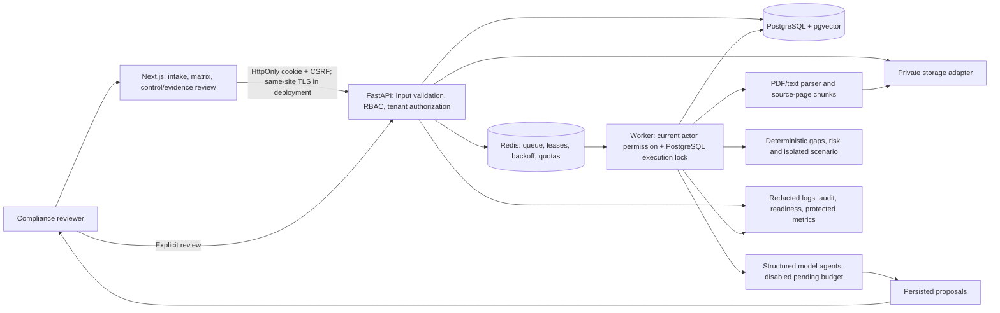
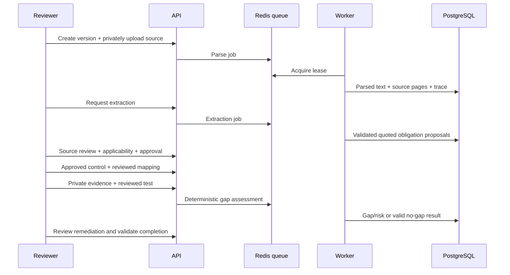

# RegulaAI architecture: current implementation

The application is a modular monolith with a separate background worker. This diagram represents the inspected code. Planned investigation/chat, OCR and autonomous regulatory discovery are not implemented product capabilities.

## Source-backed interactive diagram

[Download the interactive HTML](.archify/architecture-regulaai-20261010-035812/regulaai.html) and open it in a browser for source links, light/dark themes and export controls. The Archify specification pins source revision `9e0ca676c6432321e6ae8003e4c81ec9884960d3`. All four delivery gates pass, with browser checks and light/dark visual review recorded in [diagram evidence](docs/evidence/architecture-diagram.json).

## System overview

## Boundaries and persistence

- API routes authenticate and check organization membership/permissions before accessing tenant resources or linked records. Workers load trusted organization targets and recheck the initiating actor's current permission. Agent query context applies tenant criteria to scoped models.
- PostgreSQL stores documents/versions, obligations/applicability, controls/policies, reviewed mappings, evidence/tests, gaps/risk, remediation, changes/impact, simulation snapshots, JWT revocation and audit/agent traces.
- Development uses private local files. Staging/production require S3-compatible storage with encryption, blocked public access and versioning. There are no publicly served source paths.
- Redis handles atomic tenant/job/input-revision deduplication, priority queues, delayed retries and processing leases. Current worker lease ownership is checked before publishing results. PostgreSQL locks and completed-run replay protect repeated execution; domain agents also deduplicate selected persisted outputs. Redis/job retention and database traces are separate.
- Model outputs use Pydantic schemas and untrusted-data instructions. Extraction quotes must be exact source spans. Model IDs must belong to supplied tenant candidates. Evidence/testing results remain proposals; consequential transitions require an authorized human reviewer.
- Session cookies are HttpOnly, SameSite=Lax, Secure in staging/production; mutations require CSRF. Logout persists token revocation. Production hostname, origin, Redis protection and private storage settings fail closed.

## Actual workflow

The browser test replaces only extraction model calls with an explicit synthetic fixture. Parser, queue, worker, authorization and domain persistence are real. Manual review/recorded tests are not represented as autonomous AI reasoning.

## Deployment status and limits

Dockerfiles, a provider-neutral Compose template and two Render profiles exist: `render.hackathon.yaml` for free temporary synthetic demos and `render.yaml` for the separate S3-backed preview with a paid worker. The hackathon profile embeds the worker in the API process and uses ephemeral local uploads; the diagram above shows the logical S3-capable architecture. Neither profile is a verified live service. No release image, cloud IAM, managed backups or alert delivery has been verified. See [Render deployment](docs/RENDER_DEPLOYMENT.md) and [operations](docs/OPERATIONS.md).

Vector storage is currently version-level. Local keyword retrieval works; obligation-level embedding ingestion and calibrated hybrid reranking remain incomplete. Version change/impact, cross-regulation and contradiction agents exist but have no scored real model run. Policy extraction has not completed a real model/multi-page demonstration. Investigation/planning tool selection and its product interface remain missing. Do not present those planned paths as verified features.
